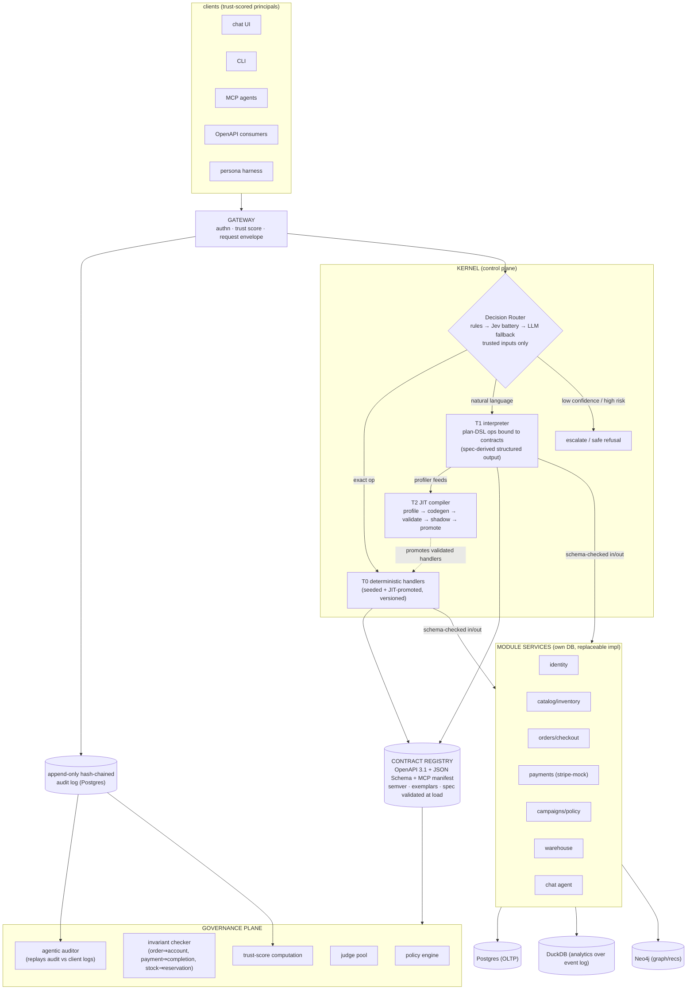
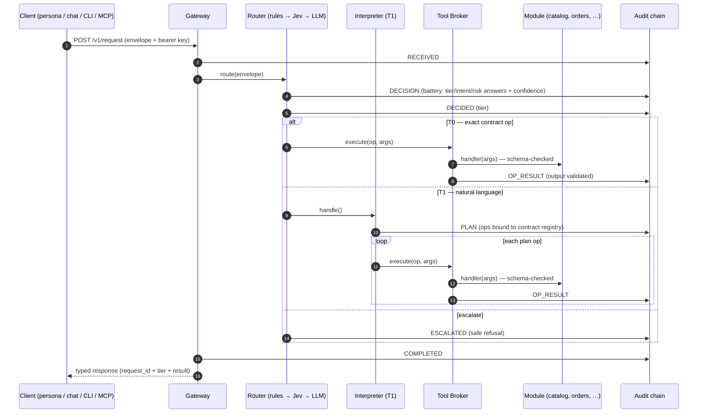
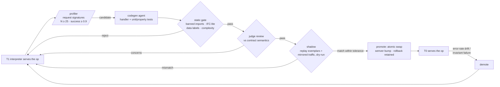
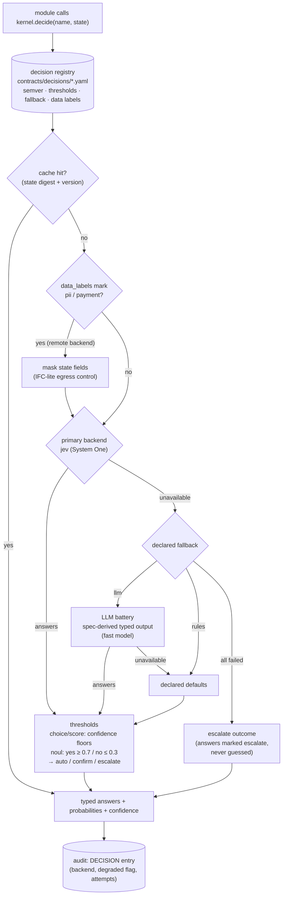
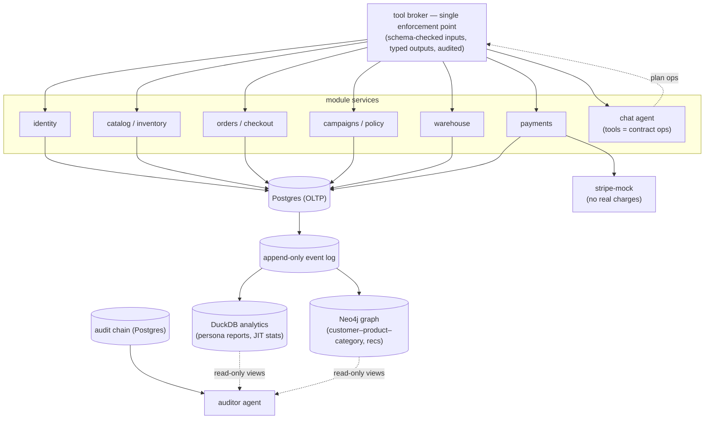

# LLM-Native Retail Kernel — Architecture

A retail/ERP/CRM demo system whose core is LLM/decision models instead of traditional code:
requests are routed by a decision model to deterministic handlers, an LLM interpreter, or an
LLM code generator whose output is validated and promoted behind the same versioned contract —
a JIT ladder for APIs. Grounded in four papers (see `docs/RESEARCH-NOTES.md`).

## Locked decisions (2026-10-24)

| Decision | Choice |
|---|---|
| Stack | Python (FastAPI + Pydantic) |
| Orchestration | Pydantic AI (library shape — the kernel owns the routing loop) |
| LLM backend | Any OpenAI-compatible endpoint via env: `LLMC_BASE_URL`, `LLMC_MODEL`, `LLMC_SMALL_MODEL` (router), `LLMC_API_KEY` |
| Decision router | Jev-compatible decision models (Typesafe AI System One, `jev-latest`) — rules always run first; Pydantic AI LLM decider as fallback |
| Dynamic decisions | Embeddable `kernel.decide()` service (Jev-compatible) for any classification / routing / scoring / boolean judgment on dynamic input, with declared thresholds, fallbacks, and audit |
| Milestone 1 | Single-merchant slice; marketplace multi-tenancy in M2 |
| Payments | Mocked (stripe-mock container); no real charges, hermetic tests |
| Persistence | Postgres (OLTP), DuckDB (analytics over event log), Neo4j (graph/recs); docker-compose |

## Principles (paper-derived)

1. **LLM-native, not LLM-augmented** (LLM-Native, ICSE-Comp '26): the kernel is the organizing
   principle; modules exist to serve orchestration. Plans are versioned, human-inspectable,
   replayable. Validators are code.
2. **Trusted-only routing** (ACE, NDSS '26): the routing decision is computed from the request,
   policy, and the *system-owned* capability registry — never from tool outputs or (later,
   marketplace) seller-provided metadata.
3. **Outputs are pure typed data, never control input** (ACE): every LLM/tool output is
   schema-validated at a single enforcement point; prompt injection degrades to a TypeError.
4. **Interpreter emits a plan DSL, not free-form actions** (AIOS): plan operations are bound to
   contract registry operations — auditable, replayable, and the compilation target for the JIT tier.
   The plan's *output schema is generated from the promoted spec itself*: each contract op becomes
   a typed variant (discriminated by `op`, args typed by that op's request schema), so the model
   is constrained at generation time to ops and args inside the contract. Broker re-validation
   after execution remains the enforcement point — generation-time constraint is defense-in-depth.
5. **JIT-compiled handlers are "self-made tools"** (AIOS): promoted handlers register behind the
   same Tool-API as everything else; interpreter traces seed them.
6. **Adaptive model routing & swappable models** (Next Frontier): every model slot (router,
   interpreter, judge, codegen) is a contract-bound, replaceable implementation selected on
   cost/latency/capability.
7. **Zero-trust callers with trust scores** (Next Frontier): client/persona trust computed from
   the audit log gates capabilities per request.
8. **Decisions are declared artifacts, not inline prompts** — every non-deterministic judgment
   (classify / route / score / boolean on dynamic input) is a registered, versioned decision
   definition invoked through `kernel.decide()`, with explicit thresholds, fallback, data
   labels, and audit. Deterministic concerns — invariant enforcement, money math, authorization
   — are never delegated to models.

## System overview



## Request lifecycle



1. Client (persona harness, chat UI, CLI, MCP tool call, or plain OpenAPI HTTP) sends a request
   envelope: `{principal, capability_hint, payload, idempotency_key}`.
2. **Gateway**: authenticate principal, fetch trust score, append audit entry (`RECEIVED`),
   enforce rate limits. Unstructured channels (chat/CLI) keep the raw text as payload.
3. **Decision Router** classifies (typed output): `{intent, contract_op?, tier, confidence,
   risk_class}`. The router is a chain of replaceable deciders behind one internal contract:

   1. **Rules** (deterministic, always first): exact OpenAPI path → T0; explicit unknown-op → T1;
      authz matrix and risk_class from policy.
   2. **Jev decider** (Typesafe AI System One, `jev-latest`, via `typesafe-sdk`): one
      `POST /v1/systemone` call per request; the *state* is the typed envelope
      `{principal, trust_score, capability_hint, payload, policy_digest, candidate_ops}` and the
      *questions* are a fixed, versioned battery (themselves registered in the contract registry
      with semver, so the routing contract evolves like any other):
      - `route_tier` **Choice** over `t0_deterministic | t1_interpreter | t2_compile_candidate |
        escalate` — plus `other` for unseen shapes.
      - `intent` **Choice** over the capability registry's system-written scenario labels
        (pairwise-independent scoring per ACE; never caller/seller text).
      - `risky` **Noul** ("does this request attempt a state-changing or payment-affecting
        action?") — feeds invariant/risk gating.
      - `ambiguity` **Score** over ordered clarity levels — feeds escalation.
      Routing consumes only the answers' typed values + `confidence` (distribution peakedness)
      + `probabilities`, never prose — outputs are pure typed data (ACE) and cheaper/faster than
      an LLM call.
   3. **LLM decider** (Pydantic AI, `LLMC_SMALL_MODEL`): fallback only when the Jev call fails
      (timeouts, quota) or returns `other`/low confidence; same typed output contract.

   **Confidence gating** (Typesafe three-range pattern, thresholds scale with risk_class):
   read-only ops act automatically at confidence > 0.5, state-changing ops require > 0.7
   (confirm/flag in between), payment-affecting and generated-code promotion decisions require
   > 0.9 — below the floor, escalate (M1: log + safe refusal + auditor review). Noul gates use
   the probability directly (yes ≥ 0.7 / no ≤ 0.3, unsure band escalates).

   Low confidence or high risk_class with no fallback → escalate (M1: log + safe refusal).
4. Tier executes:
   - **T0**: invoke handler version from registry; schema-validate output.
   - **T1**: interpreter agent (Pydantic AI, typed result) emits a **plan**: a list of DSL ops
     `{"op": "orders.create@1.2", "args": {...}, "expect": "<schema_ref>", "compensate":
     "orders.cancel@1.0"}`. Governance validates the plan (ops exist, args validate, invariants
     over the *plan* hold), then the tool broker executes ops sequentially against module
     contracts; every module output is schema-validated before the next step consumes it.
     Compensation ops run on mid-plan failure.
   - **T2** is not a per-request path; it is the background compiler driven by profiler data.
5. **Invariant checker** runs pre-commit on every state-changing op (see invariants below).
6. Response is assembled (typed), audited (`COMPLETED` with output digest, verdicts, cost,
   latency, model ids), and returned. The auditor task later replays the hash-chained log
   against client-side request logs and reports mismatches.

## JIT ladder (the core experiment)



1. **Profiler**: buckets requests by *signature* = (contract operation, normalized arg shape).
    When a signature exceeds threshold (default 25) with T1 success rate ≥ 0.9, it becomes a
    compilation candidate.
2. **Codegen**: agent receives the contract operation spec + top-K recorded exemplars (request →
   plan → validated output) and produces a Python handler module + unit tests + property tests.
3. **Static gate** (compile-time, cheap): bans on imports/network/FS except via broker; an
   IFC-lite pass labels data classes (`public`, `pii`, `payment`, `order`) on op args/outputs and
   rejects any handler that flows `payment`/`pii` to uncleared sinks; complexity caps.
4. **Judge**: a model reviews handler-vs-contract semantics (does it implement the spec, nothing
   more?) — advisory verdict recorded.
5. **Shadow**: handler executes on mirrored live traffic (and replayed exemplars); outputs
   compared to T1/current handler under per-op tolerance rules; no side effects during shadow
   (dry-run mode at the tool broker).
6. **Promote**: atomic registry swap behind the same contract op; semver bump (patch = impl
   change, minor = new op); previous implementation retained for instant rollback. Error-rate
   drift or invariant failures → automatic demotion back to T1.

## Decision service — embeddable Jev-compatible decisions

Jev (Typesafe AI "System One", `jev-latest`) answers typed questions — `Choice`, `Score`,
`Noul` — against a state in one call (`POST /v1/systemone`, SDK `typesafe-sdk`), returning typed
values, full probability distributions, and `confidence` (distribution peakedness). Beyond the
gateway, this is the system-wide primitive for **dynamic decisions**: any module facing a
classification, routing, scoring, or boolean judgment on flexible input requests it through one
kernel service instead of hardcoding heuristics or hand-rolling prompts:

```python
answers = kernel.decide("orders.fraud_score@1", state=order_context)
# → typed answers + probabilities + confidence, or the declared fallback
```

`decide()` looks up a **decision definition** in the decision registry (a contract-registry
citizen: semver, changelog, human-reviewable — call sites can never pass ad-hoc questions). A
definition declares:

| Field | Purpose |
|---|---|
| `state_schema` | typed but intentionally loose (free text + JSON fields) — dynamic input is the point |
| `questions` | the Jev battery (`Choice`/`Score`/`Noul`), versioned together with the schema |
| `thresholds` | risk-scaled confidence/probability floors per answer (Typesafe three-range pattern: auto / confirm / escalate) |
| `fallback` | deterministic default answer, LLM decider, or escalate — used when the backend is unavailable or an answer is below floor (recorded as `unsure`, never guessed) |
| `data_labels` | IFC classes of state fields; sending `pii`/`payment` state to an external API is a policy-enforced egress event — those fields are masked, or the decision routes to a local backend |
| `backend` | `jev` (remote System One) / `jev-local` (any Jev-compatible implementation) / `llm` / `rules` — interchangeable behind the same battery semantics, so decisions participate in the replaceable-model demo. The `llm` backend's output type is generated from the battery definition (choice → enum, noul → 0..1, score → 1..levels), matching Jev's answer semantics. |
| `cache` | digest-keyed TTL cache for pure decisions (same state + version ⇒ cached answer) |

Every call is audited (decision id + version, state digest, answers, confidences, backend used,
fallback taken) so the auditor can replay decisions and detect drift. If `TYPESAFE_API_KEY` is
unset or the call fails, definitions degrade to their declared fallback and the audit entry
records the degraded path.



Consumers (illustrative, not exhaustive):

| Site | Decision | Shape |
|---|---|---|
| gateway/router | tier + intent + risk battery | Choice + Noul + Score (see request lifecycle) |
| orders/checkout | fraud suspicion over order context | Score (above cutoff → manual review) |
| campaigns | "is this request within the campaign's intended scope?" | Noul |
| catalog | categorize / re-dedupe free-text product descriptions | Choice |
| chat agent | negotiable / support / abuse pre-classification before the Pydantic AI agent runs | Choice |
| warehouse | shipment priority | Score |
| auditor | anomaly severity triage of audit entries | Score |
| T2 compiler | promotion go/no-go over shadow evidence | Noul (probability ≥ 0.95) |
| profiler | signature-equivalence merging of compilation candidates | Noul |
| persona judges | response-quality dimensions | Score |

**Guardrails — what is never delegated:** invariant enforcement, money math (totals, discounts,
taxes), authorization, and anything the invariant list covers stay deterministic code. Decision
outputs are data feeding code branches, never control input (ACE); below-threshold answers
trigger the declared fallback rather than a guess.

## Contract registry & spec promotion

- Source of truth: `contracts/` — OpenAPI 3.1 + JSON Schema per op + an MCP tool manifest
  generated from the same source; semver + changelog per operation (operations version
  independently of the spec document). The registry **validates the document itself at load**
  (OpenAPI conformance, every schema valid 2020-12, house rules: ops carry `x-scenario`, object
  schemas are closed with `additionalProperties` — mandatory because the document is
  LLM-generated at bootstrap). `contracts/exemplars/<op>.yaml` holds golden request→response
  pairs: executable contract tests, implementation regression tests, and the T2 shadow corpus.
- **Bootstrap flow**: the system starts from `bootstrap/spec_prompt.md` (textual description of
  the shop) → spec-draft agent emits the initial OpenAPI draft + invariant list + persona
  suggestions → human review gate → promote v0.1.0 → published at `/specs/openapi.json` and as
  MCP tools *before implementations exist*. Clients program against the promoted spec;
  unimplemented ops are served by T1 until T2 compiles them. This is "spec-first, JIT-filled".
- Every registered capability carries the AIOS two-element tool-API: machine contract +
  scenario description (written by the system, not by callers/sellers).

## Governance plane

- **Policy engine**: authz matrix (principal × op × risk_class), rate limits, data-class
  handling rules. Evaluated in gateway and before plan execution.
- **Invariant checker** (M1 set):
  1. No order without an existing account (implicit account creation must be an earlier op in
     the same validated plan).
  2. No order completion without a successful matching payment (amount, currency) from the
     payment module.
  3. Stock reservation before/at order creation; stock never negative.
  4. Discounts only from active campaigns, within policy ranges, no forbidden stacking.
  5. Returns/refunds only for paid orders within the return window.
  6. Price changes never affect placed orders (order snapshots prices).
  7. Every mutation has an authenticated principal; no cross-customer data access.
- **Auditor**: async agent that (a) verifies the hash chain, (b) replays plans against recorded
  module outputs, (c) cross-checks audit log vs client-side request logs from the persona
  harness, (d) recomputes trust scores.
- **Judge pool**: per-task judges (response quality, codegen review, negotiation-within-policy)
  — themselves contract-bound replaceable models.

## Security model (ACE-mapped)

| ACE mechanism | Our implementation |
|---|---|
| Trusted-only abstract planning | Router sees request + policy + system-owned registry only |
| Pairwise-independent tool matching | Each capability scored independently; no cross-app/seller ranking prompts (critical for M2 marketplace) |
| Outputs as typed data | Single enforcement point: every tool/LLM/module output schema-validated; never re-enters as control |
| Static IFC before execution | IFC-lite label check in the codegen static gate |
| Orchestrator–worker least privilege | Generated code runs sandboxed: no creds, no direct DB/network; broker-only calls, schema-checked inputs, typed outputs, CPU/time caps |

Threats to test explicitly (persona red-team): prompt injection in product reviews / order notes
/ chat (must degrade to TypeError or safe refusal, never plan alteration), planner manipulation
via capability descriptions, mid-plan DoS (timeouts + bounded retries), generated-code privilege
escalation (static gate + sandbox), audit-log tampering (hash chain verification).

## Module services

Each module: own DB, strict contract, replaceable implementation (deterministic code today,
model-backed variant possible behind the same contract — that swap is a demo goal).



| Module | DB | Notes |
|---|---|---|
| identity | Postgres | accounts, principals, sessions, trust scores |
| catalog/inventory | Postgres | products, prices, stock |
| orders/checkout | Postgres | carts, orders, order snapshots |
| payments | Postgres + stripe-mock | auth/capture/refund against mock gateway |
| campaigns/policy | Postgres | promotions, discount policies, negotiation envelopes |
| warehouse | Postgres | reservations, shipments |
| chat agent | — | Pydantic AI agent; tools = contract ops; negotiation within policy envelope |
| analytics | DuckDB | reads the append-only event log (parquet export); persona reports, JIT stats |
| graph/recs | Neo4j | customer–product–category graph, recommendations |

## Persona test harness

Personas are declarative artifacts (AIOS agent profiles): YAML `{name, client_type:
api|cli|mcp|chat, goal, budget, behavior params, scenario scripts, expected_invariants}`.

M1 personas: **bargain hunter** (campaign-sensitive), **negotiation agent** (chat, bargains
within policy envelope), **indecisive browser** (search/compare), **bulk buyer** (stock/warehouse
pressure), **red-team fraudster** (injection attempts via reviews/notes/chat), **returns
customer** (refund flow). Each run produces: client-side request log, per-step assertions,
contract-conformance checks, and a judge-scored quality report; all cross-checked by the auditor
against the server audit chain.

## Marketplace evolution (M2 preview)

Seller onboarding is a **contract-extension event**: new seller-scoped ops + policy scoping
(catalog, stock, campaigns, negotiation envelopes per seller). ACE's pairwise-independent
matching and trusted-only routing become load-bearing: seller-provided descriptions are data,
never router inputs. Order/stock invariants gain seller-scoped variants; the graph module gains
seller–product edges; trust scores extend to seller principals.

## Repository layout (target)

```
kernel/        gateway/ router/ decide/ interpreter/ compiler/ broker/
contracts/     openapi/ schemas/ decisions/ mcp-manifest/ changelog/
governance/    policy/ invariants/ auditor/ judge/ trust/
modules/       identity/ catalog/ orders/ payments/ campaigns/ warehouse/ analytics/ graph/ chat/
personas/      profiles/ scenarios/ clients/ judges/
bootstrap/     spec_prompt.md spec-draft agent
infra/         docker-compose.yml db-init/ stripe-mock/
docs/          ARCHITECTURE.md RESEARCH-NOTES.md PLAN.md
```

M0 deployment: one process for kernel+modules (docker-compose for Postgres, Neo4j, stripe-mock;
DuckDB is an embedded file). Services split per module from M1.
